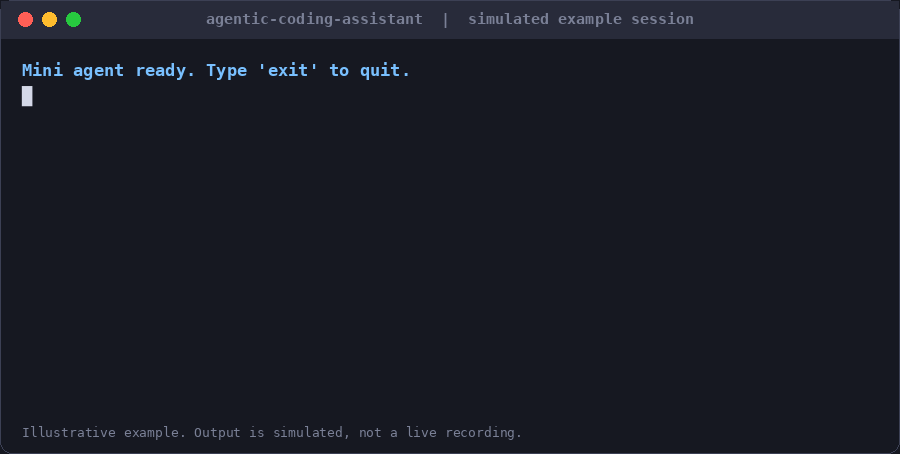
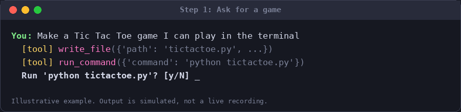
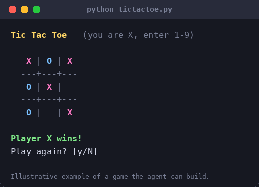
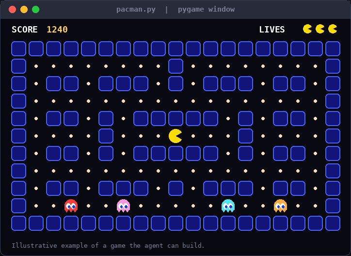
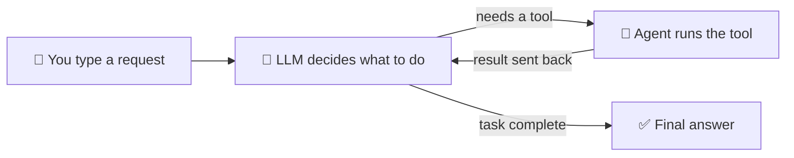

<div align="center">

# 🤖 Agentic Coding Assistant

**A tiny AI coding agent that lives in your terminal, built from scratch in pure Python.**
Tell it what you want in plain English. It reads files, writes code, and runs commands to get it done.


<!-- Replace with your real demo GIF (see "Record a demo" notes) -->


</div>

---

## 📖 Table of contents

- [What is this?](#-what-is-this)
- [See it in action](#-see-it-in-action)
- [How it works](#-how-it-works)
- [Quick start](#-quick-start)
- [Usage examples](#-usage-examples)
- [Project structure](#-project-structure)
- [Security & safety](#-security--safety)
- [Troubleshooting](#-troubleshooting)
- [Roadmap](#-roadmap)
- [Acknowledgements](#-acknowledgements)

---

## 🧠 What is this?

This is an **AI agent**: a program that does not just _answer_ questions like a chatbot, but also _takes actions_.

You type a request such as _"make me a Tic Tac Toe game"_. The agent:

1. Sends your request to a **Large Language Model (LLM)** through the OpenAI API.
2. The model decides which **tools** it needs (list files, read a file, write a file, run a command).
3. The agent runs those tools on your computer and sends the results back to the model.
4. This repeats until the model decides the job is done, then it summarizes what it did.

That repeat-until-done cycle is called an **agent loop**, and it is the core idea behind tools like Claude Code, Cursor, and GitHub Copilot's agent mode. This project builds it in about 150 lines with **no agent frameworks**, so every step is easy to read and learn from.

### ✨ Features

| Feature                    | What it does                                                                            |
| -------------------------- | --------------------------------------------------------------------------------------- |
| 📂 **List files**          | Lets the agent look around your project folder                                          |
| 📄 **Read files**          | Lets the agent understand existing code                                                 |
| ✏️ **Write files**         | Lets the agent create or edit code                                                      |
| 💻 **Run commands**        | Lets the agent run things like `python game.py` (**always asks your permission first**) |
| 🔁 **Conversation memory** | Remembers earlier messages so you can say "now make it faster"                          |
| 🛡️ **Human-in-the-loop**   | You approve every shell command before it runs                                          |

---

## 🎬 See it in action

> Replace these placeholders with your own screenshots or GIFs. Save images in an `assets/` folder.

### Building Tic Tac Toe



The agent writes the code, installs what it needs, and runs the game:



### Building Pac-Man



---

## ⚙️ How it works



In code, the heart of the project is one loop in `agent.py`:

```python
while True:
    response = client.chat.completions.create(model=MODEL, messages=messages, tools=TOOL_SCHEMAS)
    message = response.choices[0].message
    if not message.tool_calls:      # no tools requested = the model is finished
        return message.content
    for tool_call in message.tool_calls:
        result = run_tool(tool_call)   # run it, then feed the result back in
```

**Key terms, in plain English**

- **LLM**: the AI model (here, an OpenAI GPT model) that reads text and writes text.
- **Tool calling**: a feature where the model replies with "please run `read_file` on `app.py`" instead of plain text. Your code does the actual work.
- **Tool schema**: a JSON description that tells the model what each tool is called and what inputs it needs.
- **Agent loop**: the cycle of _think → act → observe_ that repeats until the task is done.
- **Human-in-the-loop**: a safety pattern where a person approves risky actions.

---

## 🚀 Quick start

### Prerequisites

- **Python 3.14+** (check with `python --version`)
- **[uv](https://docs.astral.sh/uv/)**, a fast Python package manager
- An **OpenAI API key** from [platform.openai.com/api-keys](https://platform.openai.com/api-keys)

### 1. Clone the repository

```bash
git clone https://github.com/theprotoscore/agentic-coding-assistant.git
cd agentic-coding-assistant
```

### 2. Install dependencies

```bash
uv sync
```

### 3. Add your API key

Create a file named `.env` in the project folder (it is git-ignored, so it will never be uploaded):

```env
OPENAI_API_KEY=your-key-here
```

> 💡 A template is provided as `.env.example`. You can copy it: `copy .env.example .env` (Windows) or `cp .env.example .env` (macOS/Linux).

### 4. Run the agent

```bash
uv run python agent.py
```

You should see:

```text
Mini agent ready. Type 'exit' to quit.

You:
```

---

## 💬 Usage examples

Try prompts like these:

```text
You: Make a Tic Tac Toe game I can play in the terminal
You: Build a Pac-Man style game using pygame
You: Read agent.py and explain what it does
You: Create a folder called snake-game with a main.py inside
```

When the agent wants to run a command, it **pauses and asks**:

```text
  [tool] run_command({'command': 'python tictactoe.py'})
  Run 'python tictactoe.py'? [y/N]
```

Type `y` to allow it, or anything else to decline. Type `exit` to quit.

---

## 🗂️ Project structure

```text
agentic-coding-assistant/
├── agent.py            # The whole agent: tools, schemas, agent loop, chat loop
├── pyproject.toml      # Project metadata and dependencies (managed by uv)
├── .env.example        # Template showing which secrets are needed (no real values)
├── .gitignore          # Keeps secrets and junk out of git
├── assets/             # Screenshots and demo GIFs for this README
└── README.md           # You are here
```

---

## 🔒 Security & safety

This agent can read, write, and run things on your computer, so please use it thoughtfully.

- ✅ **Commands need approval.** Nothing runs in your shell until you type `y`.
- ⚠️ **File tools are not sandboxed.** The model can read or write any file your user account can access. This includes your `.env` file, and anything it reads is sent to OpenAI. **Run the agent inside a dedicated practice folder, not your home directory.**
- ⚠️ **Read every command before approving.** Be especially careful with anything that deletes files or installs software.
- 🔑 **Never commit your API key.** Keep it in `.env` only. If a key is ever exposed, revoke it immediately in the OpenAI dashboard.
- 💸 **Watch your usage.** Each request costs a small amount of API credit. Set a spending limit in your OpenAI account.

---

## 🛠️ Troubleshooting

| Problem                                  | Fix                                                                                                  |
| ---------------------------------------- | ---------------------------------------------------------------------------------------------------- |
| `KeyError: 'OPENAI_API_KEY'`             | Your `.env` file is missing or in the wrong folder. It must sit next to `agent.py`.                  |
| `uv add pygame` fails to build           | Use `uv add pygame-ce` instead, which ships prebuilt wheels for newer Python versions.               |
| The agent uses Linux commands on Windows | Commands run in `cmd.exe` on Windows. Tell the agent "use Windows commands" or edit `SYSTEM_PROMPT`. |
| `uv: command not found`                  | Install uv from the [official guide](https://docs.astral.sh/uv/getting-started/installation/).       |

---

## 🗺️ Roadmap

- [ ] Restrict file access to the current working directory
- [ ] Add an `edit_file` tool for small changes instead of full rewrites
- [ ] Show a diff before writing over an existing file
- [ ] Stream the model's replies as they are generated
- [ ] Add automated tests

---

## 🙏 Acknowledgements

Built while following Nick Saraev's _AI Agents Full Course 2026_ on YouTube. Thanks for the clear walkthrough.

---

<div align="center">

**Built by [Franklin](https://github.com/theprotoscore)** · [Portfolio](https://franklinstack.com)

If this helped you learn something, consider leaving a ⭐

</div>
